  

  Frontend developer at <b>Samolet</b> · Vue / Nuxt / React / Next 
  NestJS, Telegram bots, Swift and VS Code themes on the side

  

  
  

  
    🎨 building <b>GotTheme</b> for VS Code &nbsp;·&nbsp;
    🤖 <b>nestjs-grammy</b> &nbsp;·&nbsp;
    🍎 <a href="https://github.com/dongaber/peppap"><b>Peppap</b></a> — dev status in the MacBook notch
  

